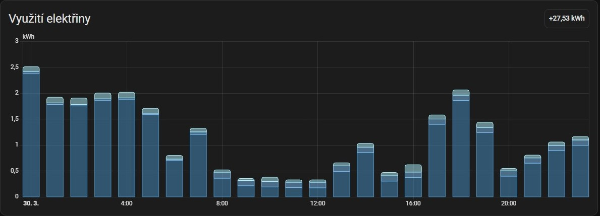
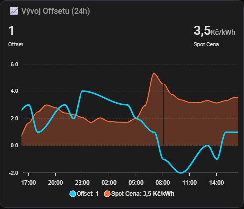
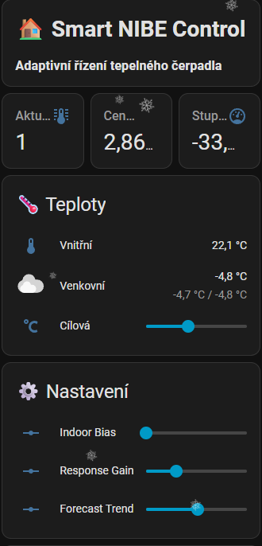

# 🏠 Smart NIBE Control – Adaptive Heat Pump Control (MQTT/Modbus or myUplink)

[](CHANGELOG.md)
[](https://www.home-assistant.io/)
[](LICENSE)

An intelligent Home Assistant blueprint that adaptively controls a NIBE heat pump by adjusting the equithermal curve (Modbus register 47011). The system **does not toggle the compressor** — it smoothly optimizes thermal output based on 8 independent factors.

**Two ways to write the offset – pick one in the blueprint:**
- **MQTT / Modbus** – [NibePi](https://github.com/anerdins/nibepi) or any Modbus–MQTT bridge (default)
- **NIBE / myUplink integration** – the offset `number` entity is set directly, no NibePi or MQTT broker needed

---

## ✨ What the system does

| Component | Description |
|-----------|-------------|
| 🌡️ **Equithermal** | Base calculation from outdoor temperature |
| ⚡ **Spot prices** | Increases heating when electricity is cheap, reduces when expensive |
| 🏠 **Indoor temperature** | Corrects offset based on deviation from target temperature |
| ☀️ **Solar braking** | Limits heating between 9–15 h on sunny days |
| 🔮 **Pre-heating** | Warms the house 1–8 h before electricity prices rise |
| 📊 **Degree-minutes** | Protects the compressor and prevents bivalence activation |
| 🌤️ **Forecast bonus** | Responds to weather forecast (cooling/warming trend) |
| 🔧 **Smooth change** | Limits offset jump to ±1 per hour |

### 🚿 New: VV-AI – smart hot water control

An optional pyscript that learns when hot water is used (weekly profile from the BT6
temperature drop) and switches the hot water comfort mode (register 47041:
Economy / Normal / Luxury) based on that profile, the electricity price and PV surplus,
with BT6/BT7 safety floors. It runs next to the blueprint: the blueprint controls
heating (47011), VV-AI controls hot water (47041).

➡️ Description and installation (Czech): [docs/vv-ai.md](docs/vv-ai.md) · files in [`vv_ai/`](vv_ai/)

---

## 🧮 How it calculates

The resulting offset is the sum of all components:

```
offset = spot_influence + equithermal_influence + indoor_influence × gain
       + bonus_6h_block + preheat_bonus − solar_malus
       + forecast_bonus + cop_bonus
```

### Spot price influence (v4.4)
```
spot_influence = (−0.3 × price [currency/kWh]) + 1.5
```

| Electricity price | Offset influence |
|------------------|-----------------|
| 2 units/kWh | **+0.9** (slightly increases heating) |
| 5 units/kWh | **0.0** (neutral) |
| 10 units/kWh | **−1.5** (slightly reduces) |

> 💡 **v4.4:** The spot price influence was intentionally reduced 3× (previously coefficient −0.8/+4.0). The system now prioritizes indoor comfort over aggressive price optimization.

### Indoor temperature correction
```
temp_diff = indoor_temperature − (target_temperature + indoor_bias)
```
Correction is non-linear (±0.3, ±0.7, ±1.5) and multiplied by `indoor_response_gain`.

---

## 📋 Requirements

- **NIBE heat pump** (S-series, F-series with VVM 320/500)
- **Home Assistant** 2024.1+
- **One of:**
  - **NibePi bridge** or equivalent Modbus–MQTT bridge + **MQTT broker** (Mosquitto), or
  - the **NIBE / myUplink integration** (offset written directly to its `number` entity – choose *How to write the offset → entity*)
- **MQTT broker** is optional with myUplink – it is only used for the debug payload, status text and history
- **Spot prices** – integration e.g. Nordpool / Amber Electric
- **Outdoor temperature** – sensor or weather integration
- **Indoor temperature** – sensor in the living space

---

## 🚀 Installation

### 1. Import the blueprint

[](https://my.home-assistant.io/redirect/blueprint_import/?blueprint_url=https://github.com/Samot89/Smart-NIBE-Control-HA-Modbus-MQTT-myUplink/blob/main/smart_nibe_control.yaml)

Click the button above, or import it manually:
```
Settings → Automations → Blueprints → Import Blueprint
```
and paste the URL of the **blueprint file** (not of the repository):
```
https://github.com/Samot89/Smart-NIBE-Control-HA-Modbus-MQTT-myUplink/blob/main/smart_nibe_control.yaml
```
> ⚠️ The repository URL (`https://github.com/Samot89/Smart-NIBE-Control-HA-Modbus-MQTT-myUplink` or `.git`) does not work – Home Assistant downloads the GitHub web page instead of the YAML and fails with `mapping values are not allowed here ... --tab-size-preference: 4;`.

Alternatively copy `smart_nibe_control.yaml` to `/config/blueprints/automation/` and reload automations.

### 2. Create helpers (input_number)

| Helper | Min | Max | Step | Recommended value |
|--------|-----|-----|------|-------------------|
| `input_number.indoor_bias` | −1.0 | 1.0 | 0.1 | **0.0** |
| `input_number.indoor_response_gain` | 0.5 | 1.5 | 0.1 | **1.5** |

> 💡 Since **v4.8** the weather forecast trend is calculated by the blueprint itself from the hourly
> forecast of the selected weather entity – the helpers `weather_forecast_trend` / `weather_forecast_avg_6h`
> are no longer needed (the trend helper is only an optional fallback for weather entities without an hourly forecast).

> ⚠️ `indoor_bias = 0.0` ensures the effective target temperature matches the value set in the thermostat. Negative values cause the system to react later.

### 3. Configure the automation
Create a new automation from the blueprint and assign entities:
- Outdoor temperature sensor
- Indoor temperature sensor
- Target temperature sensor
- Electricity spot price sensor
- NIBE degree-minutes sensor
- Heat curve number entity (e.g. `number.heat_offset_s1`)

### 4. Optional: Dashboard
Import ready-made cards from [DASHBOARD.md](DASHBOARD.md).

---

## ⚙️ Key parameters

| Parameter | Description | Recommendation |
|-----------|-------------|----------------|
| `indoor_bias` | Systematic correction of target temperature | 0.0 (no correction) |
| `indoor_response_gain` | Sensitivity of indoor temperature correction | 1.5 (max) |
| `offset_min` / `offset_max` | Range of the resulting offset | −3 / +3 |
| `step_limit` | Max offset change per hour | 1.0 |
| `dm_threshold` | Degree-minute protection threshold | −400 |

---

## 📊 MQTT sensors (debug)

Since v4.9 every run also publishes a plain-text **status** (what it is doing and why) and every
write is added to an **offset history** – see *Status text and history* in [Helpery.md](Helpery.md).

The blueprint automatically publishes diagnostics:

```yaml
sensor.nibe_offset_debug          # JSON with breakdown of all components
sensor.nibe_spot_price_influence  # Spot price component
sensor.nibe_indoor_correction     # Indoor temperature component
sensor.nibe_equithermal_influence # Equithermal component
sensor.nibe_final_offset          # Resulting offset before write
sensor.last_nibe_offset           # Last written offset
```

---

## 🖼️ Screenshots






---

## 📝 Changelog

### v4.4 (2026-03-02)
- **Spot price influence reduced 3×**: coefficient −0.8 → −0.3, offset +4.0 → +1.5
- Indoor temperature now dominates control
- Recommendation: `indoor_bias = 0.0`, `indoor_response_gain = 1.5`

### v4.3
- Added COP bonus (±0.8 based on compressor efficiency)
- Improved forecast bonus

### v4.0–v4.2
- Equithermal calculation, solar braking, 6h cheap electricity block

Full changelog → [CHANGELOG.md](CHANGELOG.md)

---

## 🤝 Acknowledgements

- [NIBE](https://www.nibe.eu/) – heat pump manufacturer
- [nibepi](https://github.com/anerdins/nibepi) – Modbus bridge
- [Home Assistant](https://www.home-assistant.io/) community

## ☕ Support

If you like this project and it helped you, you can buy me a coffee:

[](https://paypal.me/sulc89)

Thank you! Donations are voluntary, the project stays free.

---

## 📄 License

MIT © [Samot89](https://github.com/Samot89)
